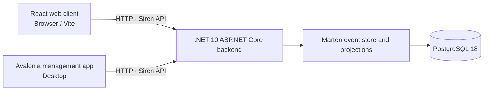

# Sci-Fi LARP Network

Sci-Fi LARP Network is a configurable in-game information network and event-management platform for science-fiction live-action role-playing games (LARPs). Each LARP can define its own networks, groups, skills, labels, themes, and fictional content; the product is designed to remain franchise-neutral rather than require any one setting.

The repository is a modern reimplementation informed by the legacy `Holonet3` project. It is not a drop-in replacement: legacy data import and backward compatibility are not included. The initial product scope includes player and character administration, events, messaging, news, files and datapads, items, configurable fictional conditions and workbenches, QR workflows, and event printouts. See the [product scope and language](docs/architecture/domain-language-and-scope.md) for the approved capability list and boundaries.

## Architecture

The system has three applications. The React web client and Avalonia management desktop client both communicate with the backend over its Siren hypermedia API. Only the backend accesses the datastore; PostgreSQL stores the durable event streams through Marten, with projections used for read models.



During local frontend development, Vite proxies `/api` requests to the backend at `http://localhost:5000`. The management app uses that same API address by default. Neither client connects directly to PostgreSQL.

The implementation is in progress. The backend currently provides API discovery/OpenAPI and the durable event-store foundation; the React and Avalonia applications provide their client shells. Most player-facing workflows, feature-specific administration, and authentication are not implemented yet. Follow the [implementation order](docs/specifications/SPEC-22-implementation-order.md) for delivery status.

## Development prerequisites

Install the following for the parts of the solution you intend to run:

- Git.
- The .NET 10 SDK. The repository pins SDK `10.0.100` in `global.json` and allows later feature-band releases.
- Node.js `26.13.0` and npm for the frontend (the version used by CI).
- Docker Engine or Docker Desktop with the Docker Compose V2 plugin for the local PostgreSQL service. Compose leaves the platform unspecified so Docker selects the image for the host architecture; the official image provides x64 and ARM64 variants.

The PostgreSQL setup is intended for local development and tests, not production. The application development settings contain local-only sample credentials. Do not reuse them in a deployed environment.

## Start the local database

Run these commands from the repository root on Windows, Linux, or macOS:

```text
docker compose up -d
docker compose ps
```

Wait for the `postgres` service to show `healthy`. The Compose service creates:

- `scifilarnetwork_dev` for running the backend locally.
- `scifilarnetwork_tests` for database-backed integration tests.

PostgreSQL is published only on loopback port `5432`; its data persists in the `postgres_data` named volume. If that port is already in use, change the host-side port mapping in `compose.yaml` and update the backend and integration-test connection strings to match. The test database initialization script runs only when PostgreSQL first initializes an empty volume. If you have an older volume, create the test database manually or reset the volume only if you are certain its data can be discarded:

```text
docker compose down -v
docker compose up -d
```

`docker compose down -v` permanently deletes the local database data. To stop the service while preserving data, use `docker compose down`.

## Run the backend

The backend is an ASP.NET Core application in `Backend/src/Host`. Start PostgreSQL first, then select the Development environment so the local connection string in `appsettings.Development.json` is loaded. The commands below use port `5000`, which is the default target expected by both clients.

PowerShell:

```powershell
$env:DOTNET_ENVIRONMENT = "Development"
dotnet run --project Backend/src/Host/SciFiLarpNetwork.Backend.csproj --urls http://localhost:5000
```

Linux or macOS shell:

```sh
DOTNET_ENVIRONMENT=Development dotnet run --project Backend/src/Host/SciFiLarpNetwork.Backend.csproj --urls http://localhost:5000
```

The API discovery entry point is `http://localhost:5000/api`; the initial versioned entry point is `/api/v1`, and the OpenAPI document is `/openapi/v1.json`. The host loads `appsettings.json` and `appsettings.{Environment}.json`. Environment variables override JSON settings; for example, `ConnectionStrings__EventStore` overrides `ConnectionStrings:EventStore`. Production settings intentionally contain no database credentials and require an operator-provided connection string. Never point integration tests at development or production data.

See [backend API setup and configuration](docs/architecture/backend-api.md) for API details and deployment configuration.

## Run the frontend

From the repository root, copy the example environment file to a local override, then install dependencies and start Vite.

PowerShell:

```powershell
Copy-Item Frontend\.env.example Frontend\.env.local
Set-Location Frontend
npm ci
npm run dev
```

Linux or macOS shell:

```sh
cp Frontend/.env.example Frontend/.env.local
cd Frontend
npm ci
npm run dev
```

Vite serves the app at `http://localhost:5173` and proxies `/api` to `http://localhost:5000` by default. Change `VITE_BACKEND_ORIGIN` in `Frontend/.env.local` if the backend uses another origin. Useful checks and build commands are `npm run check` and `npm run build` (run from `Frontend`). See the [React web client guide](docs/architecture/react-web-client.md) for path-base and API behavior details.

## Run the management app

Start the backend first, then run the Avalonia desktop client from the repository root:

```text
dotnet run --project Management/src/SciFiLarpNetwork.Management.csproj
```

The app reads and saves `appsettings.json` beside its executable. Its default API address is `http://localhost:5000/api`; ensure the backend is listening there or change `apiBaseUrl` in the settings file beside the executable. That directory must be writable for saved settings to persist. The management client communicates only through the backend API and does not access the database directly. See the [Avalonia management app guide](docs/architecture/avalonia-management-app.md) for settings behavior and limitations.

## Run tests

Start PostgreSQL with the Compose instructions above before running the complete .NET test suite, since backend integration tests use `scifilarnetwork_tests`:

```text
dotnet test SciFiLarpNetwork.slnx --configuration Release
```

Run frontend checks separately from `Frontend`:

```text
npm ci
npm run check
```

See the [testing strategy](docs/architecture/testing-strategy.md) for test-project organization, database isolation, and coverage details.

## Further documentation

- [Architecture and project layout](docs/architecture/project-layout.md)
- [Product scope and domain language](docs/architecture/domain-language-and-scope.md)
- [Backend API](docs/architecture/backend-api.md)
- [React web client](docs/architecture/react-web-client.md)
- [Avalonia management app](docs/architecture/avalonia-management-app.md)
- [Datastore decision](docs/architecture/datastore-assessment.md)
- [Testing strategy](docs/architecture/testing-strategy.md)
- [Specifications](docs/specifications/)